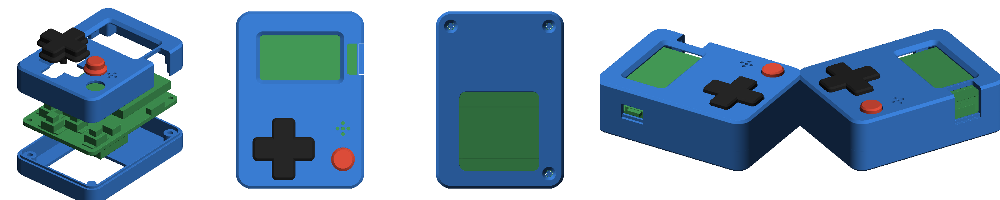

# 3D Printable Case for the CH32V003 Mini Game Console
A screwed case for the [CH32V003 Mini Game Console](https://github.com/wagiminator/CH32V003-GameConsole) (PCB v1.1, 35.56 x 50.8 mm) with a one-piece D-pad and a fire button. All parts print on an FDM printer without supports.



## Parts
| File | Print orientation | Notes |
|---|---|---|
| `GameConsole_case_top.stl` | front side down (as in the file) | front plate with OLED window, button holes, buzzer holes, notches for the power switch and the programming header |
| `GameConsole_case_bottom.stl` | bottom side down (as in the file) | back with three screw posts, a support post and a window for the CR2032 battery |
| `GameConsole_button_dpad.stl` | top side down (as in the file) | rocking cross with a pivot in the middle; diagonals work too |
| `GameConsole_button_fire.stl` | top side down (as in the file) | |

All files are already in print orientation, with the flat side on the bed. All overhangs are at most 45 degrees (chamfered OLED window, sloped collars of the buttons and matching chamfers in the button holes, countersinks), and there are no bridges.

Recommended settings: 0.2 mm layer height (0.1-0.15 mm for the buttons looks nicer), 3 perimeters, 20 % infill, PLA or PETG. If your printer prints holes too small, increase `CAP_CL` in the script (clearance of the buttons, default 0.3 mm) and generate the files again.

## Access
- **Programming header (SWIO: VCC, GND, DIO):** The case has an open notch above the 3-pin header on the right edge, from the top and the side. A Dupont plug of the WCH-LinkE fits onto the pins without opening the case. If the header isn't populated, pogo pins or an angled header can be used.
- **Power switch:** It is reached through a notch in the left wall.
- **Battery:** The CR2032 holder on the back is exposed through a window in the bottom part. If the battery can't be changed through it in your holder, remove the three screws.
- **OLED:** The window is 25 x 14 mm (the visible area is 21.7 x 10.9 mm) with a 45 degree chamfer.

## Assembly
1. Put the D-pad and the fire button into their holes from the inside of the top part (front plate down on the table).
2. Put the PCB with the OLED facing down into the top part. The three corner pillars of the top part rest on the PCB around the mounting holes.
3. Put the bottom part on. Its inner rim fits into the step of the top part's wall.
4. Fasten everything with three **M2 x 12 (or x 14) countersunk screws** from the back. The screws cut their own thread into the 1.6 mm holes of the top part's pillars. Don't over-tighten them.

## Dimensions
- Outside dimensions: 39.8 x 55.0 x 18.0 mm (top part 10.6 mm, bottom part 8.4 mm, of which 1.0 mm is the joint).
- Space above the PCB: 7.4 mm (OLED module about 6 to 6.6 mm, tact switches 6 mm).
- Space below the PCB: 6.2 mm (battery holder CR2032-BS-6-1: 5.5 mm).
- The buttons stand 1.4 mm out of the front.

## Generating the STL Files
The case is described in `gen_case.py` with signed distance functions and meshed with marching cubes (Python 3 with NumPy and scikit-image):
```
python3 gen_case.py stl 0.2     # output folder, voxel size in mm
python3 check_case.py           # collision check against the parts on the PCB, mesh check
python3 render_case.py          # preview pictures
```
The positions of the board outline, the mounting holes, the buttons, the buzzer, the power switch, the programming header and the battery holder come from the v1.1 Gerber files. The heights come from the datasheets of the parts. All important values (clearances, wall thickness, heights) are parameters at the top of `gen_case.py`.

## License
Like the CH32V003 Game Console project, this work is licensed under the Creative Commons Attribution-ShareAlike 3.0 Unported License (http://creativecommons.org/licenses/by-sa/3.0/).
